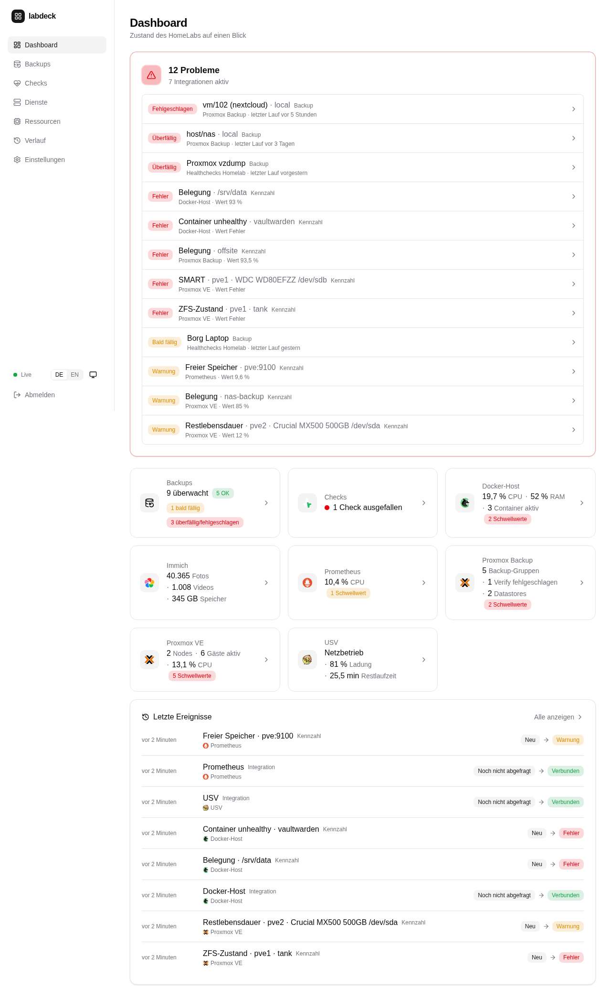
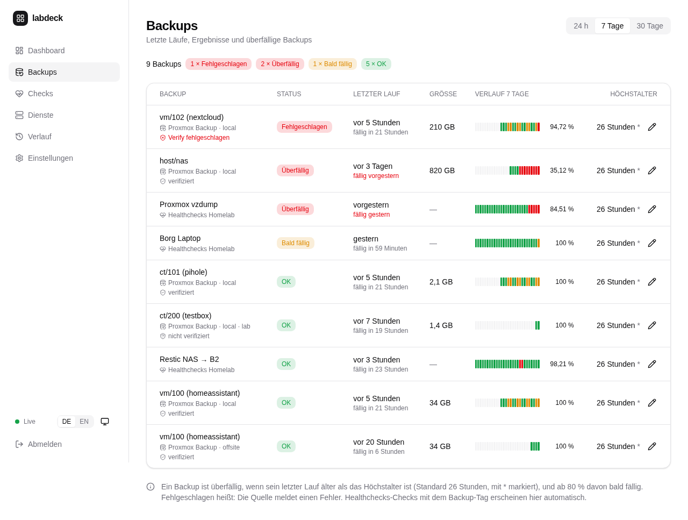
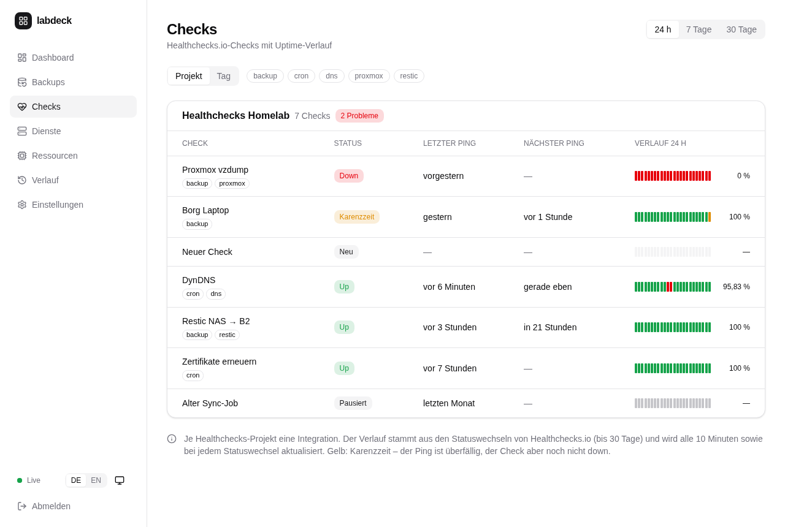
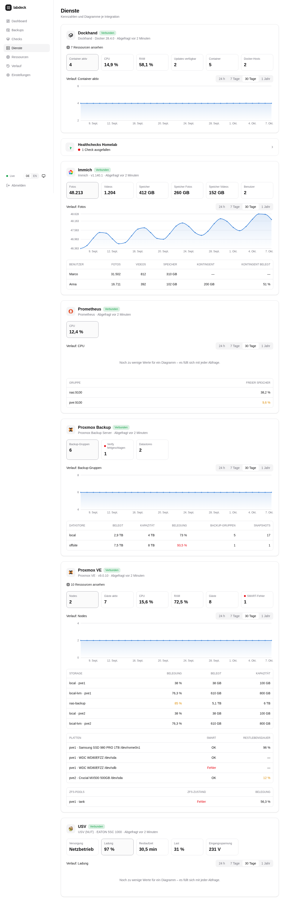
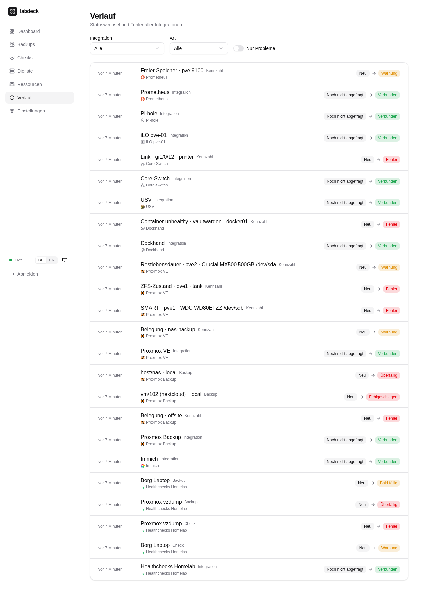

<div align="center">

# labdeck

**Selbst gehostetes HomeLab-Dashboard – Backups, Healthchecks und Kennzahlen deiner Dienste auf einen Blick.**

[](https://github.com/mrcdlm/labdeck/actions/workflows/ci.yml)
[](https://github.com/mrcdlm/labdeck/releases)
[](LICENSE)

[English](README.md) · Deutsch



</div>

labdeck zeigt, ob im HomeLab alles in Ordnung ist: Wann lief welches Backup zuletzt, ist es
überfällig, melden sich die Cron-Jobs, wie voll sind die Datastores, wie viele Fotos liegen in
Immich. Probleme stehen ganz oben, alles andere ist einen Klick entfernt. labdeck läuft als
ein einziger kleiner Container (amd64 und arm64) mit eingebauter Weboberfläche und
SQLite-Datenbank – und **alles wird im Web-UI eingestellt**, auch die Zugangsdaten der Dienste
(verschlüsselt gespeichert).

Schwesterprojekt von [dnsdeck](https://github.com/mrcdlm/dnsdeck) – gleiche Optik, gleicher Stack.

## Funktionen

- **Gesamtstatus** – eine Ampel für das ganze HomeLab; überfällige oder fehlgeschlagene
  Backups, ausgefallene Checks, nicht erreichbare Dienste und überschrittene Schwellwerte
  stehen ganz oben.
- **Backups** – alle Backups aller Quellen in einer Tabelle: letzter Lauf, Ergebnis, Größe,
  Fälligkeit, Verlauf als Balken. Ab 80 % des Höchstalters *bald fällig*, danach *überfällig*
  (Standard 26 Stunden, je Backup einstellbar).
- **Healthchecks.io** (Cloud oder selbst gehostet) – alle Checks mit Uptime-Balken für 24 h /
  7 Tage / 30 Tage aus dem Statusverlauf, gruppiert nach Projekt oder Tag, Tag-Filter. Checks
  mit einem Tag (Standard `backup`) erscheinen zusätzlich als Backup.
- **Proxmox Backup Server** – letzter Snapshot, Größe und Verify-Status je VM, Container und
  Host (alle Namespaces), Belegung der Datastores mit Schwellwerten.
- **Immich** – Fotos, Videos und Speicher gesamt und je Benutzer (mit Kontingent), Verlauf als
  Diagramm.
- **Beliebige JSON-Schnittstellen** (HTTP-JSON) – Werte per GJSON-Pfad auslesen, mit Einheit
  und Schwellwerten. Ein Zeitstempel kann als Alter angezeigt und als Backup gewertet werden –
  so lässt sich jedes Backup-Werkzeug mit Status-JSON überwachen (Uptime Kuma, Paperless,
  Nextcloud, Home Assistant … ohne eigenen Code).
- **Prometheus** – beliebige PromQL-Abfragen mit Einheit und Schwellwerten, eine Zeile je
  Label-Wert; alles, was Exporter liefern (node_exporter, restic-/borg-Exporter, SMART …).
- **Proxmox VE, Dockhand und USV** – CPU, RAM und Platte jedes Nodes, jeder VM, jedes LXC- und
  Docker-Containers (alle Docker-Hosts aus Dockhand, inkl. Health und ausstehender Image-Updates) auf einer Ressourcen-Seite mit Füllständen und Verlauf; Storages, SMART,
  ZFS, vzdump-Sicherungen; USV im Batteriebetrieb als Problem.
- **Switches per SNMP** (v2c/v3) – jeder Switch mit Standard-MIBs (Cisco C1300, UniFi, MikroTik,
  TP-Link, Netgear …): schematische Front mit RJ45/SFP-Ports, Link, Geschwindigkeit, Traffic,
  Auslastung und Fehler je Port; überwachte Ports (mit Beschreibung oder ausgewählt) als Problem.
- **Server-Hardware per Redfish** – HPE iLO, Dell iDRAC, Lenovo XCC, Supermicro: Zustand je
  Komponente, Netzteile, Lüfter, Temperaturen, Laufwerke/RAID mit SSD-Restlebensdauer, Leistung.
- **Pi-hole** (v6) – Anfragen, geblockt %, Clients, Alter der Blockliste, Blocken an/aus, Updates.
- **Dienste-Seite und Diagramme** – eine Karte je Integration mit Kennzahlen und Diagramm
  (24 Stunden bis 1 Jahr; Rohwerte 30 Tage, Tageswerte 1 Jahr, einstellbar).
- **Verlauf** – Statuswechsel und Fehler aller Integrationen, filterbar.
- **Benachrichtigungen per Webhook** – Vorlagen für ntfy, Gotify, Discord, Slack, Telegram und
  Home Assistant; Check down/wieder up, Backup überfällig/fehlgeschlagen/wieder OK,
  Integration nicht/wieder erreichbar, Schwellwert überschritten.
- **Dashboards nach Wunsch** – mehrere Dashboards als Reiter (z. B. Übersicht, Netzwerk,
  Hardware); Kacheln direkt auf dem Dashboard ziehen und in der Größe ändern; eigene
  Kennzahl-Kacheln aus jeder Integration als Zahl, Sparkline, Diagramm (bis zu drei Reihen) oder
  Tacho; Live-Kacheln mit der letzten Stunde in voller Auflösung (Abfrage ab 5 s).
- **Live** – Änderungen erscheinen sofort (Server-Sent Events); mobil nutzbar; Hell/Dunkel/
  System; Deutsch und Englisch; als App installierbar (PWA).
- **Sicher voreingestellt** – läuft ohne Root auf einem Distroless-Image; Zugangsdaten mit
  AES-256-GCM verschlüsselt und nie von der API ausgeliefert; Login mit einem Passwort und
  Begrenzung der Fehlversuche.

| Backups | Checks | Dienste | Verlauf |
|---|---|---|---|
|  |  |  |  |

## Schnellstart

Voraussetzung: Docker mit dem Compose-Plugin.

```sh
mkdir labdeck && cd labdeck
curl -fsSLO https://raw.githubusercontent.com/mrcdlm/labdeck/main/deploy/docker-compose.yml
curl -fsSL  https://raw.githubusercontent.com/mrcdlm/labdeck/main/deploy/.env.example -o .env
chmod 600 .env
openssl rand -base64 32                     # → LABDECK_SECRET_KEY
nano .env                                   # APP_PASSWORD und LABDECK_SECRET_KEY setzen

mkdir -p data && sudo chown 65532:65532 data   # der Container läuft als UID 65532
docker compose pull && docker compose up -d
docker compose ps                           # nach etwa 30 Sekunden "healthy"
```

`http://<host>:8080` öffnen, mit `APP_PASSWORD` anmelden und die Dienste unter
**Einstellungen → Integrationen** hinzufügen. `LABDECK_SECRET_KEY` gut aufbewahren – ohne ihn
lassen sich gespeicherte Zugangsdaten nicht entschlüsseln.

## Konfiguration

Nur das Nötigste steht als Env-Variable in `.env`
(Vorlage: [`deploy/.env.example`](deploy/.env.example)). Integrationen, Zugangsdaten,
Schwellwerte, Dashboard und Benachrichtigungen werden im Web-UI eingestellt.

| Variable | Pflicht | Beschreibung |
|---|---|---|
| `APP_PASSWORD` | ja | Passwort für die Weboberfläche (Klartext oder bcrypt-Hash, max. 72 Bytes) |
| `LABDECK_SECRET_KEY` | ja | 32 Byte, Base64 (`openssl rand -base64 32`) – verschlüsselt Zugangsdaten der Integrationen und Webhook-Tokens |
| `LABDECK_VERSION` | ja (Compose) | Image-Version, z. B. `0.8.0` – bewusst fest, kein `latest` |
| `LABDECK_PORT` | nein | Port auf dem Host (Standard `8080`) |
| `TZ` | nein | Zeitzone der Log-Zeitstempel (Standard `UTC`); die Zeitzone der Anzeige wird im Web-UI eingestellt |
| `SECRET_*` | nein | Zugangsdaten, auf die Integrationen als `${SECRET_NAME}` verweisen (statt sie einzutragen) |
| `WEBHOOK_*` | nein | Geheimnisse, auf die Webhooks als `${WEBHOOK_NAME}` verweisen |
| `TRUSTED_PROXIES` | nein | IPs oder Netze (CIDR) des Reverse Proxys / `cloudflared`, z. B. `172.16.0.0/12`, siehe [Sicherheit](#sicherheit) |
| `LOG_LEVEL` | nein | `debug`, `info`, `warn` oder `error` (Standard `info`) |

## Integrationen

Unter **Einstellungen → Integrationen** hinzufügen; das Formular erklärt jedes Feld.
„Verbindung testen“ prüft Adresse und Zugangsdaten vor dem Speichern. Jede Integration hat
ihr eigenes Abfrageintervall (Standard 60 s), Timeout und TLS-Prüfung (für selbst signierte
Zertifikate im LAN ausschaltbar). Mehrere Instanzen je Typ sind möglich.

| Integration | Zugangsdaten | Was du bekommst |
|---|---|---|
| Healthchecks.io | API-Key je Projekt (Read-only genügt) | Checks, Uptime-Balken, Checks mit Tag `backup` als Backups |
| Proxmox Backup Server | API-Token `benutzer@realm!name`, Rolle **DatastoreAudit** auf `/datastore` für das Token | Backups je VM/CT/Host, Verify-Status, Belegung der Datastores |
| Immich | API-Key eines **Admins** mit der Berechtigung `server.statistics` | Fotos, Videos, Speicher, je Benutzer |
| HTTP-JSON | optional ein Header mit Zugangsdaten (verschlüsselt gespeichert) | beliebige Werte, Zeitstempel als Backups |
| Prometheus | keine, Basic Auth oder Bearer-Token | beliebige PromQL-Abfragen |
| Proxmox VE | API-Token `benutzer@realm!name`, Rolle **PVEAuditor** auf `/` | Auslastung je Node, VM und Container, Storages, SMART, ZFS, Sicherungen |
| Dockhand | API-Token `dh_…` (nur bei aktiver Anmeldung in Dockhand) | CPU/RAM je Docker-Host und Container, Health, ausstehende Updates |
| USV (NUT) | optional upsd-Benutzer | Netz/Batterie, Ladung, Restlaufzeit, Last |
| Switch (SNMP) | SNMP v2c (Read-only-Community) oder v3 (Benutzer mit Lese-View, SHA/AES) | Ports mit Link, Traffic, Auslastung, Fehlern; schematische Front |
| Server-Management (Redfish / iLO) | BMC-Benutzer nur mit Recht **Login** (iLO) bzw. **ReadOnly** (iDRAC) | Zustand je Komponente, Netzteile, Lüfter, Temperaturen, Laufwerke, Leistung |
| Pi-hole | **App-Passwort** (Einstellungen → Web-Oberfläche / API), leer ohne Passwort | Anfragen, geblockt %, Clients, Blockliste, Blocken an/aus |

**SNMP auf dem Cisco C1300 einschalten:** in der Weboberfläche unter *Security → SNMP* SNMP
aktivieren, dann entweder eine Community mit Zugriff *Read Only* anlegen (v2c) oder eine Gruppe
mit Lese-View und einen Benutzer mit *Authentication* und *Privacy* (v3, empfohlen); die IP von
labdeck als Management-Station eintragen. Andere Switches: gleiche Idee, nur Lesezugriff.
Passt die gezeichnete Front nicht (z. B. Kombi-Ports), lässt sie sich im Formular mit
*Frontlayout* festlegen, etwa `24 rj45, 4 sfp`.

**iLO 5:** einen eigenen Benutzer nur mit dem Recht *Login* anlegen; das Zertifikat ist meist
selbst signiert – dann unter *Erweitert* die TLS-Prüfung ausschalten.

**Backups von Proxmox VE (vzdump) mit Healthchecks.io überwachen:** einen Check mit dem Tag
`backup` und einem Zeitplan passend zum Backup-Job anlegen und vzdump per Hook-Skript pingen
lassen:

```sh
#!/bin/sh
# /usr/local/bin/vzdump-hc.sh – in /etc/vzdump.conf aktivieren: script: /usr/local/bin/vzdump-hc.sh
URL="https://hc-ping.com/DEINE-CHECK-UUID"
MARK=/run/vzdump-hc-failed
ping() { curl -fsS -m 10 --retry 3 "$URL$1" >/dev/null 2>&1; }
case "$1" in
  job-start)    rm -f "$MARK"; ping /start ;;
  backup-abort) touch "$MARK" ;;
  job-abort)    ping /fail ;;
  job-end)      if [ -e "$MARK" ]; then ping /fail; else ping ""; fi ;;
esac
exit 0
```

Zusammen mit der Integration für Proxmox Backup Server siehst du beides: ob der Job pünktlich
lief (Healthchecks.io) und was je VM tatsächlich gesichert ist (PBS).

## Benachrichtigungen

Unter **Einstellungen → Webhooks** beliebig viele Webhooks anlegen (Methode, URL, Header,
Body-Template mit Live-Vorschau). Vorlagen gibt es für ntfy, Gotify, Discord, Slack, Telegram
und Home Assistant. Geheimnisse gehören nie direkt in URL oder Header: ins Feld **Token**
eintragen (verschlüsselt gespeichert) und als `${TOKEN}` verwenden (im Body `{{token}}`);
Klartext-Geheimnisse werden abgelehnt. Alternativ auf Env-Variablen `${WEBHOOK_NAME}` verweisen.

Ereignisse: Check down / wieder up, Backup überfällig / fehlgeschlagen / wieder OK,
Integration nicht / wieder erreichbar, Schwellwert überschritten. Die Sprache der Nachrichten
steht unter **Einstellungen → Benachrichtigungen**.

## Aktualisieren

labdeck folgt [Semantic Versioning](https://semver.org). Die
[Release Notes](https://github.com/mrcdlm/labdeck/releases) lesen, `LABDECK_VERSION` in `.env`
auf die neue Version setzen und ausführen:

```sh
docker compose pull && docker compose up -d
```

Zurück geht es genauso mit der vorherigen Version. Datenbank-Migrationen laufen beim Start
automatisch; vor größeren Updates das Datenverzeichnis sichern.

## Sicherheit

- Die Weboberfläche spricht nur HTTP. **Port 8080 nicht ins Internet freigeben.** Über einen
  Reverse Proxy mit TLS oder einen Cloudflare Tunnel veröffentlichen, am besten mit
  Cloudflare Access davor.
- Hinter einem TLS-Proxy wird das Session-Cookie automatisch als `Secure` markiert
  (`X-Forwarded-Proto: https`). `TRUSTED_PROXIES` setzen, damit labdeck die echte
  Client-Adresse sieht (Login-Begrenzung, Logs).
- Zugangsdaten der Integrationen und Webhook-Tokens werden mit AES-256-GCM verschlüsselt
  (`LABDECK_SECRET_KEY`) und nie von der API ausgeliefert, geloggt oder in Fehlermeldungen
  gezeigt.
- Ausgehende Anfragen gehen nur an eingerichtete Integrationen und Webhooks; die API ist kein
  Proxy.
- Schreibende Anfragen von fremden Seiten werden abgelehnt (CSRF-Schutz).

Sicherheitslücken bitte wie in [SECURITY.md](SECURITY.md) beschrieben melden.

## Entwicklung

Voraussetzungen: Go 1.27, Node.js 24.

```sh
# Nachgebaute APIs aller unterstützten Dienste (Healthchecks, Immich, PBS, Prometheus, JSON, Webhook-Empfänger)
go run ./cmd/mock -addr :8790

# Backend
APP_PASSWORD=test LABDECK_SECRET_KEY=$(openssl rand -base64 32) DATA_DIR=./data go run ./cmd/server

# Frontend mit Hot Reload (leitet API-Anfragen an :8080 weiter)
cd web && npm install && npm run dev
```

Adressen und Keys der Mock-Dienste stehen oben in [`cmd/mock/main.go`](cmd/mock/main.go)
(z. B. Healthchecks: `http://localhost:8790/healthchecks`, Key `hc-readonly`).
`go run ./cmd/devseed -db ./data/app.db` erfindet ein Jahr Verlauf für die Diagramme.

Prüfungen (laufen alle in der CI):

```sh
go vet ./... && go test ./...
cd web && npm run lint && npm run build
cd e2e && npm ci && npx playwright install chromium && npx playwright test
```

Die Screenshots in `docs/screenshots` entstehen mit `cd e2e && npm run screenshots`.

## Releases

Ein Tag `vX.Y.Z` baut Multi-Arch-Images (`linux/amd64`, `linux/arm64`) und veröffentlicht sie
auf `ghcr.io/mrcdlm/labdeck` als `X.Y.Z`, `X.Y` und `latest` (ab 1.0 zusätzlich `X`), samt
GitHub-Release; jeder Push auf `main` veröffentlicht `main`. Änderungen stehen im
[Changelog](CHANGELOG.md).

Entwickelt wird auf einem selbst gehosteten Forgejo; dieses GitHub-Repository ist ein
Push-Spiegel ([Einrichtung](docs/forgejo-mirror.md)). Issues und Pull Requests sind hier
willkommen – übernommene Änderungen landen auf Forgejo und kommen mit der nächsten
Synchronisation zurück.

## Lizenz

[MIT](LICENSE)
