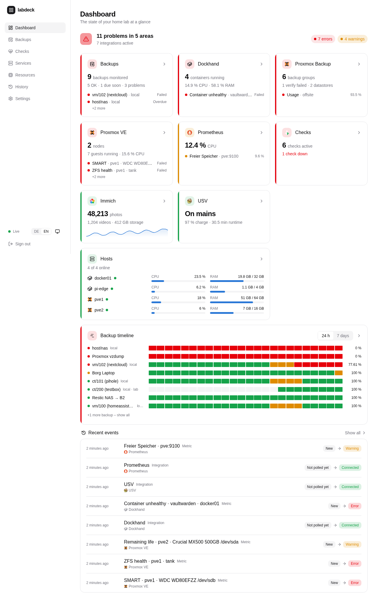
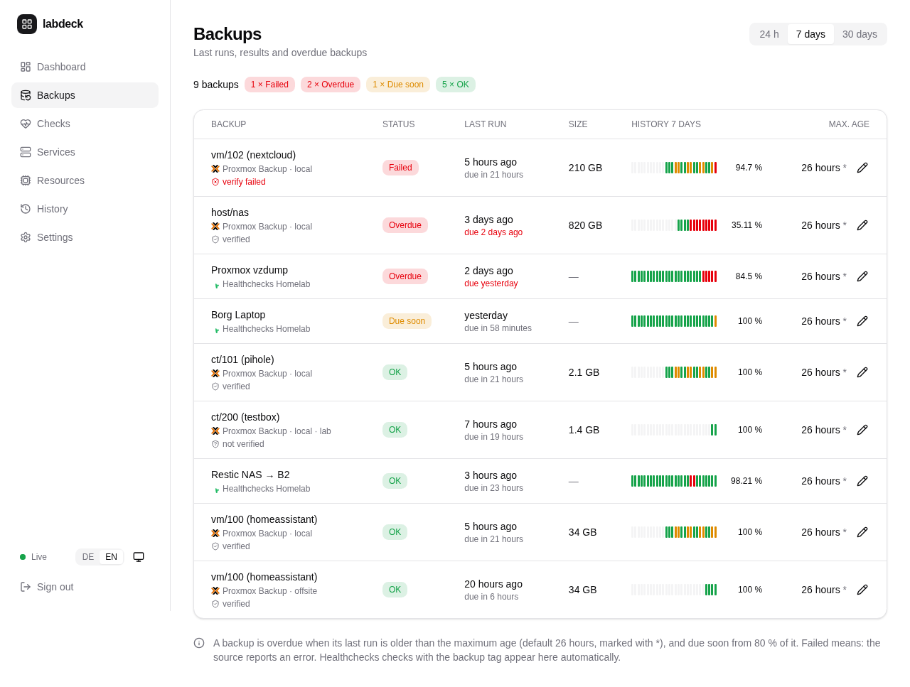
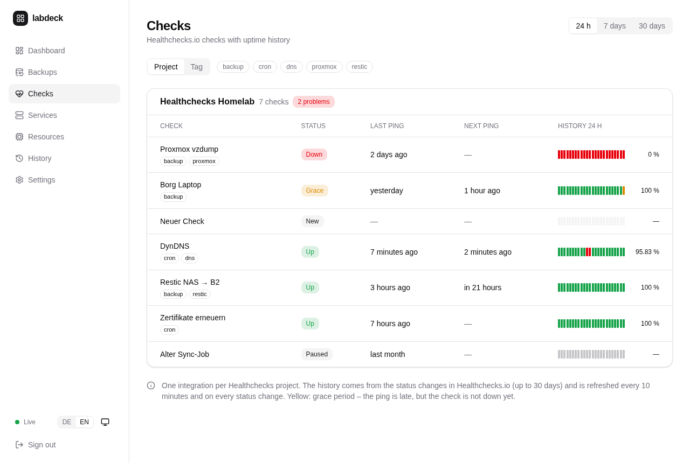
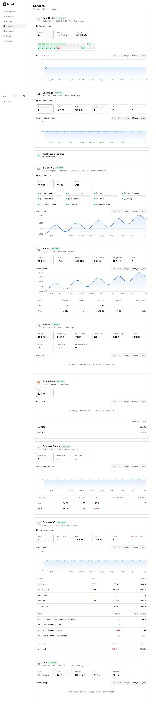
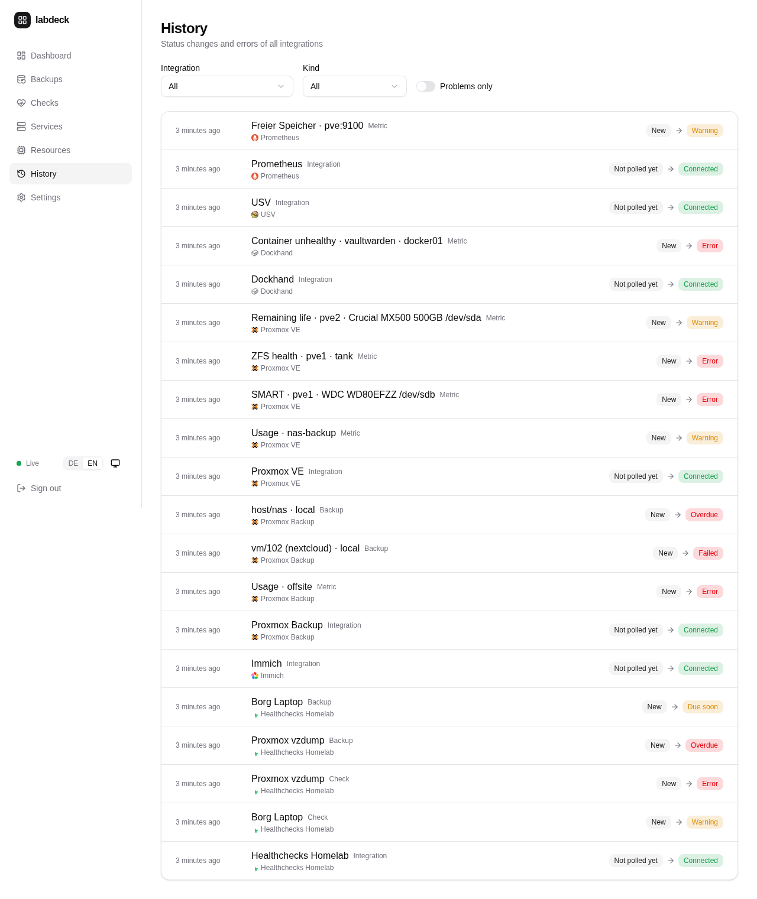

<div align="center">

# labdeck

**Self-hosted home lab dashboard – backups, health checks and service metrics at a glance.**

[](https://github.com/mrcdlm/labdeck/actions/workflows/ci.yml)
[](https://github.com/mrcdlm/labdeck/releases)
[](LICENSE)

English · [Deutsch](README.de.md)



</div>

labdeck shows whether everything in your home lab is fine: when did which backup last run, is
it overdue, are your cron jobs reporting, how full are your datastores, how many photos are in
Immich. Problems are listed at the top, everything else is one click away. It ships as a
single small container (amd64 and arm64) with an embedded web interface and an SQLite
database – and **everything is configured in the web interface**, including the credentials
of your services (stored encrypted).

Sister project of [dnsdeck](https://github.com/mrcdlm/dnsdeck) – same look, same stack.

## Features

- **Overall status** – one traffic light for the whole home lab; overdue or failed backups,
  checks that are down, unreachable services and exceeded thresholds are listed first.
- **Backups** – every backup from all sources in one table: last run, result, size, when it
  is due, history bar. A backup is *due soon* from 80 % of its maximum age and *overdue*
  after it (default 26 hours, adjustable per backup).
- **Healthchecks.io** (cloud or self-hosted) – all checks with 24 h / 7 day / 30 day uptime
  bars from the status history, grouped by project or tag, tag filter. Checks with a tag
  (default `backup`) also appear as backups.
- **Proxmox Backup Server** – last snapshot, size and verify state per VM, container and host
  (all namespaces), datastore usage with thresholds.
- **Immich** – photos, videos and storage in total and per user (with quota), history chart.
- **Any JSON API** (HTTP JSON) – read values with GJSON paths, with unit and thresholds. A
  timestamp can be shown as its age and treated as a backup, so any backup tool with a status
  file can be monitored (Uptime Kuma, Paperless, Nextcloud, Home Assistant … without code).
- **Prometheus** – any PromQL queries with unit and thresholds, one row per label value;
  everything exporters provide (node_exporter, restic/borg exporters, SMART …).
- **Proxmox VE, Dockhand and UPS** – CPU, RAM and disk of every node, VM, LXC and Docker
  container (all Docker hosts managed by Dockhand, incl. health and pending image updates) on a resources page with meters and history; storages, SMART, ZFS, vzdump backups;
  UPS on battery as a problem.
- **Switches via SNMP** (v2c/v3) – any switch with standard MIBs (Cisco C1300, UniFi, MikroTik,
  TP-Link, Netgear …): schematic front panel with RJ45/SFP ports, link, speed, traffic,
  utilisation and errors per port; monitored ports (with a description or selected) as problems.
- **Server hardware via Redfish** – HPE iLO, Dell iDRAC, Lenovo XCC, Supermicro: health per
  component, power supplies, fans, temperatures, drives/RAID with SSD remaining life, power draw.
- **Pi-hole** (v6) – queries, blocked %, clients, blocklist age, blocking on/off, updates.
- **Services page and charts** – one card per integration with its metrics and a chart
  (24 hours to 1 year; raw values 30 days, daily values 1 year, configurable).
- **History** – status changes and errors of all integrations, filterable.
- **Notifications via webhooks** – presets for ntfy, Gotify, Discord, Slack, Telegram and
  Home Assistant; check down/up, backup overdue/failed/OK again, integration
  unreachable/reachable, threshold exceeded.
- **Dashboards your way** – several dashboards as tabs (e.g. Overview, Network, Hardware); drag
  and resize tiles right on the dashboard; your own metric tiles from any integration as number,
  sparkline, chart (up to three series) or gauge; live tiles with the last hour at full
  resolution (polling from 5 s).
- **Live** – updates instantly via Server-Sent Events; works on mobile; light/dark/system
  theme; English and German; installable as an app (PWA).
- **Secure by default** – runs as non-root on a distroless image; credentials encrypted with
  AES-256-GCM and never returned by the API; single-password login with rate limiting.

| Backups | Checks | Services | History |
|---|---|---|---|
|  |  |  |  |

## Quick start

Requirements: Docker with the Compose plugin.

```sh
mkdir labdeck && cd labdeck
curl -fsSLO https://raw.githubusercontent.com/mrcdlm/labdeck/main/deploy/docker-compose.yml
curl -fsSL  https://raw.githubusercontent.com/mrcdlm/labdeck/main/deploy/.env.example -o .env
chmod 600 .env
openssl rand -base64 32                     # → LABDECK_SECRET_KEY
nano .env                                   # set APP_PASSWORD and LABDECK_SECRET_KEY

mkdir -p data && sudo chown 65532:65532 data   # the container runs as UID 65532
docker compose pull && docker compose up -d
docker compose ps                           # "healthy" after about 30 seconds
```

Open `http://<host>:8080`, sign in with `APP_PASSWORD` and add your services under
**Settings → Integrations**. Keep `LABDECK_SECRET_KEY` safe – without it the stored
credentials cannot be decrypted.

## Configuration

Only the essentials are environment variables in `.env`
(template: [`deploy/.env.example`](deploy/.env.example)). Integrations, credentials,
thresholds, dashboard and notifications are managed in the web interface.

| Variable | Required | Description |
|---|---|---|
| `APP_PASSWORD` | yes | Password for the web interface (plain text or bcrypt hash, max. 72 bytes) |
| `LABDECK_SECRET_KEY` | yes | 32 bytes, Base64 (`openssl rand -base64 32`) – encrypts credentials of integrations and webhook tokens |
| `LABDECK_VERSION` | yes (Compose) | Image version to run, e.g. `0.8.0` – pinned on purpose, no `latest` |
| `LABDECK_PORT` | no | Host port for the web interface (default `8080`) |
| `TZ` | no | Time zone for log timestamps (default `UTC`); the display time zone is set in the web interface |
| `SECRET_*` | no | Credentials referenced as `${SECRET_NAME}` in integrations (instead of entering them) |
| `WEBHOOK_*` | no | Secrets referenced as `${WEBHOOK_NAME}` in webhooks |
| `TRUSTED_PROXIES` | no | IPs or networks (CIDR) of your reverse proxy / `cloudflared`, e.g. `172.16.0.0/12`, see [Security](#security) |
| `LOG_LEVEL` | no | `debug`, `info`, `warn` or `error` (default `info`) |

## Integrations

Add them under **Settings → Integrations**; the form explains each field. "Test connection"
checks address and credentials before saving. Each integration has its own polling interval
(default 60 s), timeout and TLS verification (turn it off for self-signed certificates in your
LAN). Several instances per type are possible.

| Integration | Credentials | What you get |
|---|---|---|
| Healthchecks.io | API key per project (read-only is enough) | checks, uptime bars, checks tagged `backup` as backups |
| Proxmox Backup Server | API token `user@realm!name`, role **DatastoreAudit** on `/datastore` for the token | backups per VM/CT/host, verify state, datastore usage |
| Immich | API key of an **admin** with the permission `server.statistics` | photos, videos, storage, per user |
| HTTP JSON | optional header with credentials (stored encrypted) | any values, timestamps as backups |
| Prometheus | none, basic auth or bearer token | any PromQL query |
| Proxmox VE | API token `user@realm!name`, role **PVEAuditor** on `/` | load per node, VM and container, storages, SMART, ZFS, backups |
| Dockhand | API token `dh_…` (only if authentication is enabled in Dockhand) | CPU/RAM per Docker host and container, health, pending updates |
| UPS (NUT) | optional upsd user | mains/battery, charge, runtime, load |
| Switch (SNMP) | SNMP v2c (read-only community) or v3 (user with a read view, SHA/AES) | ports with link, traffic, utilisation, errors; schematic front panel |
| Server management (Redfish / iLO) | BMC user with only the **Login** (iLO) or **ReadOnly** (iDRAC) privilege | health per component, power supplies, fans, temperatures, drives, power draw |
| Pi-hole | **app password** (Settings → Web interface / API), empty without a password | queries, blocked %, clients, blocklist, blocking on/off |

**Enable SNMP on the Cisco C1300:** in the web UI under *Security → SNMP* enable SNMP, then
either create a community with *Read Only* access (v2c) or a group with a read view and a user
with *Authentication* and *Privacy* (v3, recommended); add labdeck's IP as management station.
Other switches: same idea, read access only. If the drawn front panel doesn't match (e.g. combo
ports), set it in the form with *Front layout*, e.g. `24 rj45, 4 sfp`.

**iLO 5:** create a dedicated user with only the *Login* privilege; the certificate is usually
self-signed – then turn off TLS verification under *Advanced*.

**Monitoring Proxmox VE backups (vzdump) with Healthchecks.io:** create a check with the tag
`backup` and a schedule matching your backup job, then let vzdump ping it via a hook script:

```sh
#!/bin/sh
# /usr/local/bin/vzdump-hc.sh – enable in /etc/vzdump.conf: script: /usr/local/bin/vzdump-hc.sh
URL="https://hc-ping.com/YOUR-CHECK-UUID"
MARK=/run/vzdump-hc-failed
ping() { curl -fsS -m 10 --retry 3 "$URL$1" >/dev/null 2>&1; }
case "$1" in
  job-start)    rm -f "$MARK"; ping /start ;;
  backup-abort) touch "$MARK" ;;
  job-abort)    ping /fail ;;
  job-end)      if [ -e "$MARK" ]; then ping /fail; else ping ""; fi ;;
esac
exit 0
```

Together with the Proxmox Backup Server integration you see both: did the job run on time
(Healthchecks.io), and what is actually stored per VM (PBS).

## Notifications

Under **Settings → Webhooks** add any number of webhooks (method, URL, headers, body template
with live preview). Presets exist for ntfy, Gotify, Discord, Slack, Telegram and Home
Assistant. Secrets never go into URL or headers directly: put them into the **token** field
(stored encrypted) and use `${TOKEN}` (or `{{token}}` in the body); plain-text secrets are
rejected. Alternatively reference environment variables `${WEBHOOK_NAME}`.

Events: check down / up again, backup overdue / failed / OK again, integration unreachable /
reachable again, threshold exceeded. The language of the messages is set under
**Settings → Notifications**.

## Updating

labdeck follows [semantic versioning](https://semver.org). Read the
[release notes](https://github.com/mrcdlm/labdeck/releases), set `LABDECK_VERSION` in `.env`
to the new version and run:

```sh
docker compose pull && docker compose up -d
```

To roll back, set the previous version and run the same command. Database migrations are
applied automatically on start; back up the data directory before major updates.

## Security

- The web interface uses plain HTTP. **Do not expose port 8080 to the internet.** Publish it
  through a reverse proxy with TLS or a Cloudflare Tunnel, ideally protected by Cloudflare
  Access.
- Behind a TLS-terminating proxy the session cookie is marked `Secure` automatically
  (`X-Forwarded-Proto: https`). Set `TRUSTED_PROXIES` so labdeck sees the real client address
  (login rate limit, logs).
- Credentials of integrations and webhook tokens are encrypted with AES-256-GCM
  (`LABDECK_SECRET_KEY`) and never returned by the API, written to logs or error messages.
- Outgoing requests only go to configured integrations and webhooks; the API is not a proxy.
- Write requests from other sites are rejected (CSRF protection).

Please report vulnerabilities as described in [SECURITY.md](SECURITY.md).

## Development

Requirements: Go 1.27, Node.js 24.

```sh
# Mock APIs of all supported services (Healthchecks, Immich, PBS, Prometheus, JSON, webhook receiver)
go run ./cmd/mock -addr :8790

# Backend
APP_PASSWORD=test LABDECK_SECRET_KEY=$(openssl rand -base64 32) DATA_DIR=./data go run ./cmd/server

# Frontend with hot reload (proxies API requests to :8080)
cd web && npm install && npm run dev
```

The addresses and keys of the mock services are listed at the top of
[`cmd/mock/main.go`](cmd/mock/main.go) (e.g. Healthchecks: `http://localhost:8790/healthchecks`,
key `hc-readonly`). `go run ./cmd/devseed -db ./data/app.db` invents a year of history for the
charts.

Checks (all run in CI):

```sh
go vet ./... && go test ./...
cd web && npm run lint && npm run build
cd e2e && npm ci && npx playwright install chromium && npx playwright test
```

The screenshots in `docs/screenshots` are generated with `cd e2e && npm run screenshots`.

## Releases

Pushing a tag `vX.Y.Z` builds multi-arch images (`linux/amd64`, `linux/arm64`) and publishes
them to `ghcr.io/mrcdlm/labdeck` as `X.Y.Z`, `X.Y` and `latest` (plus `X` from 1.0 on),
together with a GitHub release; every push to `main` publishes `main`. Changes are listed in
the [changelog](CHANGELOG.md).

Development happens on a self-hosted Forgejo; this GitHub repository is a push mirror
([setup](docs/forgejo-mirror.md)). Issues and pull requests are welcome here – accepted changes
are applied upstream and arrive with the next sync.

## License

[MIT](LICENSE)
